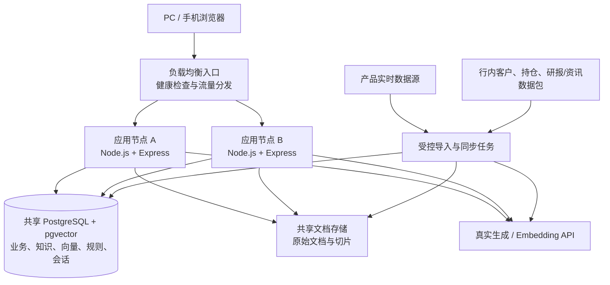
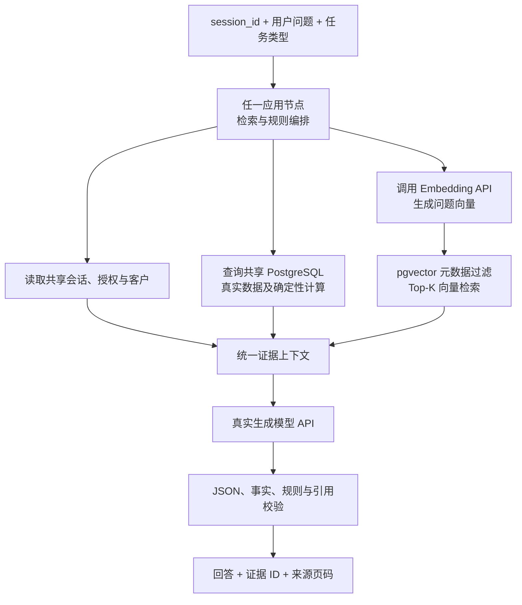

# 财富智服演示 DEMO 软件架构（裁剪版）

- 版本：V2.3
- 日期：2026-11-04
- W1 基线（方案 B）：`DATA_MODE=database` + `AI_MODE=fixture`；真实 PostgreSQL/pgvector 承载固定 fixture 业务数据与确定性知识向量，AI 由 `FixtureModelClient` 提供并返回 `execution_mode: "fixture"`；测试基线 83 项（73 单元/API + 10 DB 集成，后者需 `W1_DB_SMOKE=true`）与 15 项 Playwright 浏览器用例；本地三层门禁已全部跑绿。W1 范围与逐项完成状态以 `CONTEXT.md` 为准
- 架构目标：实现可演示、可操作、业务闭环、真实调用 AI、支持当天数据接入和产品数据实时更新的 DEMO
- **总体需求规格**：`AI财富管理智能服务产品选型测试指标.xlsx` 工作表「框架参考」**A–G 列**（指标类型、指标分类、指标项、测试目的、测试条件、测试步骤、衡量标准），有效指标行为 R2–R62 共 61 条；**H 列排除**
- **界面规格边界**：当前脚手架前端源码 `public/`（`index.html`、`app.js`、`requirements.js`、`demo-data.js`、`session-sync.js`、`style.css`），以其中实际挂载的路由、菜单、动作与 API 调用集合为准
- 原型定位：`wealth-prototype/` 与 `requirements.js` 的 F01–F33 需求索引仅作视觉与追溯参考，不再作为功能基线；索引中无运行页面的条目只显示说明、不提供跳转
- 数据基线：客户与持仓、研报/资讯使用行内提供的标准数据；产品数据由厂商准备演示当天最新数据并具备实时更新能力
- 部署约束：同一个应用服务有且只部署到两台服务器，两个实例共同提供服务并实现负载均衡（来源：`选型测试要求-财富管理智能体.docx` 测试环境表，本 DEMO 保留为运行约束）
- 实现现状：`CONTEXT.md`、`docs/architecture.md`、`docs/api-contract.md`；第 1–11 章描述本次 DEMO 的技术架构，第 0 章定义规格来源与边界

## 0. 规格基线、界面边界与需求分级

### 0.1 规格来源与排除规则

| 项目 | 内容 |
|---|---|
| 总体需求规格 | 选型测试指标 xlsx「框架参考」A–G 列；R2–R62 共 61 条指标行，R63/R64 为空行不纳入 |
| 表内空值处理 | R41「证书」衡量标准列为空；R62 指标项列为空但有测试目的、步骤和衡量标准。均以原表为准，不自行补写规格 |
| 分组列 | A（指标类型）、B（指标分类）仅在分组首行填写（R2 通过性/通用指标、R8 专用指标、R26 评价性/通用指标），后续行按表格分组延续；台账以行号 + 指标项为准，不重写分类 |
| **H 列排除** | H 列是「请逐项反馈满足情况，如有偏离请详细说明」，属于供应商自评反馈，**不构成需求规格**。本文件不以 H 列推导功能、不引用其中的「已满足/承诺可满足」结论，也不把其中的自评数字（接口数量、产品数量、实测时延、测试通过数等）当作架构事实或验收证据 |
| 界面规格边界 | `public/` 当前代码；不因 A–G 列中存在某指标而新增运行页面；指标若没有对应界面，由后端、受控脚本、文档或承诺书承载 |
| 规格优先级 | 总体需求规格（A–G 列）高于界面实现；界面实现只定义「用户可见、可操作」的范围，不裁剪总体需求，只决定其承载位置 |

### 0.2 用户交互界面边界（`public/`）

运行页面以 `app.js` 的 `pcNav`、`mobileNav`、`desktopPage()` switch、`mobilePage()` 路由表及 `index.html` 脚本引用为准。按钮动作集合位于 `public/actions/` 的四个域文件与 `actions-registry.js`，由注册表按 action 分派；页面与动作集合仍以 0.2 白名单为界。

| 区域 | 运行路由 | 数量 |
|---|---|---|
| PC 工作台 | `pc/architecture`、`pc/workspace` | 2 |
| PC 财富产品洞察 | `pc/product-fund`、`pc/product-insurance`、`pc/product-wealth`、`pc/product-deposit`、`pc/product-private`、`pc/candidates`、`pc/compare` | 7 |
| PC 财富投研 | `pc/supply`、`pc/research`、`pc/events`、`pc/macro`、`pc/industry`、`pc/library`、`pc/reader`、`pc/writing` | 8 |
| PC 公共结果 | `pc/result`（未知 PC 路由回退 `pc/architecture`，不产生新页面） | 1 |
| 手机主流程与分支 | `m/assistant`、`m/fund`、`m/insurance`、`m/wealth`、`m/deposit`、`m/private`、`m/allocation`、`m/holdings`、`m/candidates`、`m/compare`、`m/companion` | 11 |
| 手机公共结果 | `m/result`（未知手机路由回退 `m/assistant`） | 1 |
| 弹窗与浮层 | 需求清单与原型索引、使用帮助、任务中心、来源详情、工具规范、功能导航、结果承接（landing） | 非独立路由 |

**已退出运行前端**（菜单、路由分发、跨页入口均已移除，需求索引中只显示「无独立运行页面」）：`pc/delivery`、`pc/model-delivery`、`pc/rollout`、`pc/acceptance`、`pc/models`、`pc/orchestration`、`pc/standards`、`pc/integration`、`pc/select-fund`、`pc/select-wealth`、`pc/select-insurance`、`pc/sources`；同时移除全局搜索、消息中心、审核队列、发起联调、模型版本管理、来源续期申请入口。`app.js` 中残留的未挂载渲染函数（如 `pageSources()`、`pageModels()`）不构成可运行页面。

界面契约由 `index.html` 的 `api-version=v1`、`frontend-contract-version=2026-11-02.1` 标记和 `session-sync.js` 的校验固化；八类 AI 任务通过 `runRealAiTask()` 接入 `/api/ai/generate`，业务状态变更通过 `/api/sessions/:id/commands` 的六个命令执行。**规格边界只约束「用户交互界面」，不约束应用服务脱离前端被直接调用**（对应 R25）。

### 0.3 需求分级与承载方式

A–G 列中并非每条指标都对应一个运行页面。按交付形态分为五类，附录 A 给出 R2–R62 逐条映射。

| 类别 | 含义 | 主要承载 | 正式判定归属 |
|---|---|---|---|
| A 界面功能 | 有运行页面、可演示业务闭环 | `public/` 白名单页面 + 应用服务 | 本文件第 11 章 DEMO 验收；专业质量类另由行方统一评测集判定 |
| B 服务与规则能力 | 无独立运行页面或页面仅展示结果 | 应用服务 API、确定性规则、AI 编排、数据/知识/会话、审计记录 | DEMO 的 API 与数据检查；部分由行内环境验证 |
| C 受控任务与交付物 | 导入、知识加工、部署、文档、源代码 | `scripts/`、`docs/`、`db/`、Docker/Nginx 配置、架构与接口文档 | 受控脚本执行记录与交付物评审 |
| D 承诺与商务项 | 表内测试步骤为「检查承诺书/材料」，或明确不作实测 | 书面承诺书、资质材料、测试过程记录 | 行方按承诺书与评分说明判定，DEMO 不实测、不宣称满足 |
| E 行内环境/统一评测 | 70QPS、24h、多集群、四类任务各 5 次实测、各专业评测集 | 真实时延与运行日志、双节点与 `/ready`、证据链 | 行内等价环境与统一评测集；DEMO 只记录真实数据，不以单机演示宣称达标 |

分级不改变指标的存在性：C/D/E 类指标仍是总体需求规格的一部分，但不能反向要求在运行前端新增「模型管理、选品、来源接入、交付验收、容量压测」等页面。

### 0.4 追溯与判定边界

本文件只定义架构承载与本次 DEMO 的检查方式，**不判定 A–G 列指标的满足情况**；满足情况由测试方按原表 F 列测试步骤与 G 列衡量标准在规定环境判定。DEMO 不展示虚构的生产指标、不把承诺书内容表述为已实测能力、不把单机时延表述为 70QPS 或 24 小时连续运行达标。

## 1. 裁剪结论

DEMO 采用 **“一个可替换的浏览器前端 + 一个双实例无状态应用服务 + 一个负载均衡入口 + 一套共享 PostgreSQL/pgvector 数据与向量存储 + 一套共享文档存储 + 一组真实生成/Embedding API”**。

不建设通用 Agent 平台、多模型平台或微服务集群，但必须具备自动化数据导入、增量知识加工、实时产品数据更新和双节点会话一致性，不能以单机静态文件或服务端内存状态替代这些约束。总体需求规格中的承诺类、生产容量类与通用多智能体协同类指标按 0.3 的 C/D/E 分级由文档、受控任务、承诺书或行内环境承载，DEMO 不以建设平台方式实现，也不在运行前端补建入口。

系统由以下四部分组成：

1. **可替换前端展示层**：以 `public/` 当前脚手架代码为界面边界，PC 与手机网页只负责页面展示、用户输入、API 调用和异常提示，不承载权威业务状态；不新增白名单之外的运行页面。
2. **确定性业务规则**：完成授权检查、筛选、计算、状态流转、候选生成、比较和演示任务处理。
3. **统一应用与 AI 编排**：两个应用实例提供相同 API，查询共享业务数据，执行向量检索和规则校验，真实调用生成及 Embedding API。
4. **共享数据与会话**：客户、持仓、产品、知识元数据、向量、规则和业务会话均保存在共享基础设施中，两个节点不各自保存权威状态。

AI 承担自然语言问答、规则语义匹配、解释、摘要和草稿生成。AI 可以从规则目录选择 `rule_id` 并提取输入，但程序必须校验规则及前置条件后执行；模型不得修改规则动作、产品事实、指标计算、适当性结论或业务状态。生成或嵌入 API 失败时展示真实错误，不以预置答案冒充成功。

## 2. 范围与边界

### 2.1 总体需求规格与界面边界的对应

总体需求规格取 xlsx A–G 列；下表把可由用户界面承接的需求域映射到 `public/` 实际运行路由。路由名是当前脚手架的实现事实，前端技术栈和页面布局可替换，但不得超出 0.2 的界面集合，也不得改变业务语义、前置条件或流程闭环。

| 需求域（指标行号） | 界面边界（`public/` 运行路由） | DEMO 承载方式 |
|---|---|---|
| 产品洞察 R8、R9、R43–R45 | `pc/product-fund`、`pc/product-insurance`、`pc/product-wealth`、`pc/product-deposit`、`pc/product-private`、`pc/compare`、`m/fund`、`m/insurance`、`m/wealth`、`m/deposit`、`m/private` | 事实字段来自共享产品数据；解释与一页纸调用真实模型；五类覆盖、客观题与解读质量由行方统一评测集判定 |
| 持仓诊断 R10、R46 | `m/holdings`、`m/fund` | 资产合计、占比、集中度由确定性计算；`diagnosis_explain` 只解释已计算事实 |
| 配置、候选与比较 R47–R49 | `m/allocation`、`m/candidates`、`m/compare`、`pc/candidates`、`pc/compare` | `rule_match → generate_allocation → generate_candidates`；`candidate_explain` 只解释已生成候选；比较统一口径、缺失值不补齐 |
| 投研、事件与解读 R11、R12、R51、R52 | `pc/workspace`、`pc/supply`、`pc/research`、`pc/events`、`pc/macro`、`pc/industry` | `research_qa` 使用真实业务数据与 pgvector 召回片段；事实、机构观点与模型推断分开表述 |
| 知识召回、阅读与写作 R17、R53、R54 | `pc/library`、`pc/reader`、`pc/writing` | `/api/knowledge` 取真实文档；`report_summary` 限定当前文档、`writing_draft` 限定已选材料；扫描件 OCR 未装配，不冒充已支持 |
| 助手、多轮与边界 R14、R56 | `m/assistant`、回答卡片、来源详情弹窗 | 共享会话保留上下文；证据不足或超范围时拒绝生成并提示，不以预置答案兜底 |
| 投后陪伴 R50 | `m/companion` | 复盘、提醒与服务建议结束于待客户经理确认 |
| 引用、一致性与观测 R13、R15、R55、R57、R62 | `pc/result`、`m/result`、回答卡片与来源详情 | 主要由 B 类能力承载：证据白名单、`request_id` 幂等、会话追踪、AI 调用审计与运行日志；界面只展示真实状态 |
| 选品、模型运营、来源接入、交付验收 R16、R18、R25–R30、R35、R38、R59 | **无独立运行页面** | 由确定性筛选规则、标准 JSON API、受控脚本、接口/设计文档与承诺书承载；需求索引中只显示说明，不提供跳转 |

### 2.2 明确不建设或不在运行前端实现的内容

- 真实交易、投保、理赔、赎回、客户触达和生产工单。
- 通用互联网搜索、无范围的外部知识抓取和任意文件公开上传。
- 大模型训练、多模型路由平台、通用 Agent 平台、MCP、A2A 和复杂任务队列（对应 R36 的裁剪说明见 0.3）。
- 超出 0.2 白名单的新页面、新角色、新指标、新业务流程或新数据服务；`wealth-prototype/` 的页面不再作为可新增功能的依据。
- 已退出运行前端的 12 个路由及其入口动作（0.2），不得因指标表中存在对应指标而补建；其能力由后端、脚本、文档或承诺书承载。
- D 类承诺与商务项（数据不出行、私有化、行内集成适配、信创、专利与授权、证书、永久使用权、二次开发、研发体验、节能环保、自主可控、应急处置、过程规范性等）不在 DEMO 实测，不建模拟页面冒充承诺书或行内系统联调。
- E 类性能与专业评测（70 QPS、24 小时连续运行、多集群、四类任务各 5 次共 20 次实测、各专业评测集评分）不作为本次 DEMO 达标结论；DEMO 只记录真实 `latency_ms`、运行状态和证据链。**双节点部署和负载均衡是必须实现的约束，不因分级删除。**
- H 列供应商逐项反馈不得写入 DEMO 验收结论或运营展示，页面不得出现虚构的生产 QPS、接口数量、评测通过率或「已满足」自评数据冒充实测。

### 2.3 外部连接

允许的外部连接仅包括：真实生成模型 API、真实 Embedding API、经批准的产品行情/资讯数据源。客户及持仓数据由行内标准数据包导入，不默认接入生产客户系统；应用服务可脱离前端通过标准 JSON API 直接调用（R25），但前端不得直连数据库、向量库或模型 API。

## 3. 最小运行与部署架构



### 3.1 运行单元

| 单元 | 职责 | 部署约束 |
|---|---|---|
| `public/` | 当前脚手架前端源码（`app.js`、`requirements.js`、`session-sync.js`、`demo-data.js`、`index.html`、`style.css`），定义 0.2 的界面边界；负责展示、表单、API 调用和异常提示 | 框架与布局可替换，但运行页面与动作集合以当前代码为界；两个节点部署相同前端构建与 `frontend_contract_version=2026-11-02.1` |
| `server.js` | 数据、知识、会话、AI 和规则接口；检索与结果校验 | 同一应用服务只部署 A、B 两个等价实例 |
| PostgreSQL | 客户、持仓、产品、知识元数据、规则、会话和验收记录 | 两个节点共同访问，不在节点内保存权威副本 |
| pgvector | 知识向量写入和 Top-K 检索 | 与知识元数据使用同一知识版本 |
| 共享文档存储 | 行内原始 DOCX/PDF 等文档、清洗文本和切片 | 两个节点读取相同内容，可使用行内共享文件或对象存储 |
| 导入/同步脚本 | 行内数据导入、产品同步、知识加工和索引更新 | 受控任务，不作为第三个在线应用实例 |
| 规则目录 | 规则 ID、版本、条件、必填字段和确定性动作 | 数据库统一保存，两个节点使用同一规则版本 |

应用节点使用 Node.js + Express；PostgreSQL + pgvector 是共享数据基础设施。导入和同步任务通过数据库锁保证同一时间只有一个执行任务，不增加新的在线业务服务。

### 3.2 可替换前端与交互契约

前端是独立展示模块：总体需求规格来自选型测试指标 A–G 列，界面边界来自 `public/` 当前代码；`wealth-prototype/` 只提供视觉参考，不提供必须继承的技术实现。前端技术栈在实现时只选择一种，架构不要求沿用当前原生 JavaScript，也不要求保留 Hash 路由，但替换后的页面与动作集合不得超出 0.2。

前端与应用服务之间必须遵守以下契约：

1. **统一 API 边界**：前端只调用应用服务 API，不直连 PostgreSQL、pgvector、共享文档存储或生成/Embedding API。
2. **会话归属清晰**：浏览器只保存 `session_id` 和页签、筛选等临时界面状态；客户、授权、方案、候选和 AI 任务状态以服务端共享会话为准。
3. **请求可追踪**：AI 和业务写操作携带 `session_id`、`request_id` 及当前会话版本，前端必须处理加载、失败、超时、重复提交和旧响应丢弃。
4. **版本兼容**：前端与 API 使用明确的 `frontend_contract_version/api_version`；不兼容的前端不得随节点发布，两个节点部署相同前端构建及接口版本。
5. **真实状态展示**：页面展示实际数据时点、知识来源、证据、规则结果和错误，不得自行伪造保存、同步、导入或 AI 调用成功。
6. **展示可替换**：替换前端布局、组件、路由或技术栈，不得要求改变共享数据、业务规则、会话模型或 AI 编排；验收按业务场景和 API 契约执行，不依赖 `wealth-prototype/` 或当前脚手架的 DOM 结构。
7. **界面边界冻结**：不得增加 0.2 白名单之外的运行页面；需求索引中标注「无独立运行页面」的条目不得补建入口；未挂载的渲染函数不得重新挂到路由上。
8. **需求不因界面裁剪**：A–G 列中无运行页面承接的指标按 0.3 的 B/C/D/E 类承载；替换前端不得删除对应的后端能力、受控脚本、文档或验收记录。

### 3.3 应用接口

接口清单取自 `src/interfaces/http/routes.js` 与 `docs/api-contract.md`，与 `public/session-sync.js` 的调用一致。

| 接口 | 用途 | 关键约束 |
|---|---|---|
| `GET /api/health` | 应用、数据、知识、模型及 `api_version=v1`、`frontend_contract_version=2026-11-02.1` 状态 | 不暴露密钥和连接串 |
| `GET /ready` | 负载均衡就绪检查 | 数据库、共享存储、知识完整性、模型/向量维度、必需规则版本与契约标记未就绪时返回 503，不接收流量 |
| `GET /api/demo-data` | 返回当前授权范围内的业务数据及数据时点 | 固定活动版本的只读快照；不返回密钥 |
| `GET /api/knowledge` | 返回知识文档、片段及知识/索引状态 | 只读当前 ACTIVE 知识版本 |
| `POST /api/sessions` | 创建共享会话 | 客户身份由服务端绑定，浏览器只持久化 `session_id` |
| `GET /api/sessions/:sessionId` | 读取权威会话状态与 `version` | 前端据此渲染，不在浏览器保存权威状态 |
| `PATCH /api/sessions/:sessionId` | 只提交用户输入与展示状态（`goal`、`compareSet`、`uiState`、AI 结果投影） | `expected_version` 乐观锁 + `request_id` 幂等；递归拒绝 `authorized`、`plan`、`candidates`、`compareSaved`、`careSubmitted` 等服务端字段 |
| `POST /api/sessions/:sessionId/commands` | 执行权威业务状态变更 | 仅六个命令；服务端校验授权、规则条件、真实产品、比较数量与前置状态后用乐观锁保存 |
| `POST /api/ai/generate` | 查询数据与知识并执行八类固定 AI 任务 | `task_type` 仅限 `rule_match`、`assistant_qa`、`research_qa`、`diagnosis_explain`、`candidate_explain`、`product_explain`、`report_summary`、`writing_draft` |

业务命令固定为 `set_authorization`、`generate_allocation`、`generate_candidates`、`save_comparison`、`submit_care`、`create_reminder`；配置链路为 `rule_match → generate_allocation → generate_candidates`。撤权、目标变化或关键产品属性变化会使下游状态失效，通用 PATCH 不能越权推进。

`POST /api/ai/generate` 请求携带 `session_id`、`session_version`、`request_id`、`task_type`、`input` 及可选 `product_ids/source_ids`，其中 `session_version` 与 UUID `request_id` 必填。客户身份、授权和持仓由服务端根据会话及数据库取得，前端不得提交并冒充权威客户上下文，也不得传入系统提示词、模型地址或向量分数（包括嵌套字段）；成功请求 ID 可重放且不重复调用模型，生成期间会话版本变化会使旧响应失效。

成功响应包含：`request_id`、`text`、`citations`、`evidence`、`data_as_of`、`model`、`finish_reason`、`latency_ms`、`risks`。`evidence` 列出实际使用的 `data_ids`、`calculation_ids`、`chunk_ids` 和召回分数。

`rule_match` 额外返回 `status`、`rule_id`、`rule_version`、`extracted_inputs`、`missing_fields` 和 `confidence`。`status` 只能为 `MATCHED`、`NEED_CONFIRMATION` 或 `UNSUPPORTED_RULE`；程序只能根据已校验的 `rule_id` 执行数据库中的本地规则动作。

### 3.4 数据、知识与向量检索进入 AI 的流程



证据上下文包括：

- `structured_facts`：实际使用的客户、持仓、产品、指标和事件，保留 `data_id`、`source_id`、`source_timestamp` 和 `data_as_of`。
- `calculations`：确定性规则产生的持仓、配置、筛选或存款结果，保留 `calculation_id` 和输入引用。
- `knowledge_chunks`：向量召回的真实知识片段，保留 `chunk_id`、`document_id`、`source_id`、页码、时点和分数。
- `customer_context`：经授权且最小必要的客户上下文；发送到外部模型前必须脱敏并使用行方批准的服务边界。
- `rule_candidates`：仅 `rule_match` 使用，包含允许选择的规则 ID、版本、适用场景、必填输入和条件，不包含可由模型改写的动作。

| AI 任务 | 数据/规则要求 | 向量知识要求 |
|---|---|---|
| 规则匹配 | 必须有有效规则目录和当前已知输入 | 可召回规则说明，但相似度不能替代条件校验 |
| 助手问答 | 尝试查询持仓、产品和事件 | 尝试召回相关知识；两路均不足时禁止生成 |
| 研究问答 | 按问题查询宏观、产品或市场数据 | 必须有有效知识片段 |
| 诊断解释 | 必须有产品事实和本地计算 | 有产品报告/条款时一并注入 |
| 候选解释 | 必须有筛选结果、目标和候选数据 | 有产品知识时一并注入，不用于改变资格 |
| 产品解释 | 必须有产品主数据 | 有说明书/公告片段时一并注入 |
| 报告摘要 | 可关联报告涉及的产品数据 | 必须限定为当前报告及片段 |
| 写作草稿 | 按写作主题注入相关数据 | 必须有已选材料或有效召回片段 |

向量检索默认最多返回 4 个片段，并按任务、产品、来源、授权范围和活动知识版本过滤。低于固定相关性阈值或元数据不匹配的结果不得进入提示词。

### 3.5 真实模型 API 配置与调用

两个应用节点使用一致的环境配置：

- `MODEL_BASE_URL`：兼容 OpenAI 协议的服务根地址，包含版本路径且不以 `/` 结尾。
- `MODEL_API_KEY`：真实密钥，只在服务端保存。
- `MODEL_NAME`：生成模型名称。
- `EMBEDDING_MODEL_NAME`：知识及问题向量使用的嵌入模型名称。
- `MODEL_TIMEOUT_MS`：生成或嵌入调用超时时间。

生成调用使用 `POST {MODEL_BASE_URL}/chat/completions`，嵌入调用使用 `POST {MODEL_BASE_URL}/embeddings`。生成请求包含 `model`、`messages`、`temperature` 和 `max_tokens`；嵌入请求包含 `model` 和 `input`。

系统提示词要求模型只使用提供的证据，区分事实与观点，不得输出交易指令或收益承诺。内容生成模型只返回包含 `text`、`citations`、`risks` 的 JSON；解析或结构校验失败时按生成失败处理。

### 3.6 启动与运行

1. 准备共享 PostgreSQL/pgvector、共享文档存储和负载均衡入口。
2. 在两台服务器部署相同应用包、前端构建产物、API 契约、数据库迁移、规则版本和环境配置。
3. 执行数据库结构校验及基础规则导入；数据和知识可在演示当天再接入。
4. 分别启动 A、B 实例，只有 `/ready` 通过的节点才加入负载均衡。
5. 通过负载均衡地址访问 PC 和手机网页，不启用会话粘滞作为一致性前提。
6. 应用节点本地磁盘不得保存权威客户、持仓、产品、知识、向量或会话状态。

## 4. 业务闭环设计

### 4.1 手机端主闭环


| 步骤 | 输入 | 处理 | 输出与下一步 |
|---|---|---|---|
| 助手问答 | 用户问题、授权客户、真实数据与知识 | 查询数据、向量召回知识并调用生成模型 | AI 回答、证据、模型信息和风险提示；可进入持仓 |
| 持仓诊断 | 行内客户与持仓、产品数据 | 计算资产合计、占比和集中度 | 持仓诊断；可进入基金诊断 |
| 基金诊断 | 基金、持仓、相关产品知识 | 规则计算，向量召回报告/公告，模型生成解释 | 保存诊断及证据；可进入资产配置 |
| 资产配置 | 金额、期限、风险、用途、流动性、授权 | AI 可提取字段并选择规则；程序校验后执行，比例合计 100% | 配置方案；生成候选的前置状态 |
| 候选推荐 | 有效方案、可售产品 | 规则筛选，模型只解释已生成的适配理由 | 实际候选及理由；可加入比较 |
| 产品比较 | 2–3 个候选 | 按相同区间和口径展示，缺失值不补齐 | 保存比较；进入投后陪伴 |
| 投后陪伴 | 持仓、方案、真实事件 | 展示复盘、事件和提醒，提交服务建议 | 结束于待客户经理确认 |

直接进入后续页面必须检查共享会话中的前置状态：无方案先完成配置；比较集不足 2 个返回候选；未授权不得生成方案。不得以默认结果绕过校验。

### 4.2 PC 投顾/投研闭环

`工作台/研究提问 → 示例数据查询 + 问题向量化 → pgvector 知识召回 → 真实生成模型 → 事实与引用校验 → 候选解释 → 产品比较 → 会话内保存`

- PC 与手机端共用同一共享会话中的 `goal`、`candidates` 和 `compareSet`。
- 研究回答只能使用本次证据上下文中的真实数据和知识片段，不自动把研究观点当作适当性结论。
- 模型回答未通过校验时不得进入候选解释，不沿用无关旧答案。
- 候选与比较集由共享会话保存，保留筛选规则版本、数据时点和 `calculation_id`；不存在独立选品池同步页面或 `sync_selection` 命令。

### 4.3 产品洞察分支闭环

- **基金/理财**：筛选 → 详情 → 模型生成一页纸或加入比较 → 事实校验 → 保存/返回。
- **保险**：授权保单 → 保障缺口或详情 → 待确认事项 → 返回；不生成核保、承保或理赔结论。
- **存款**：金额和期限 → 单利测算 → 提前支取比较 → 返回；计算不交由模型完成。
- **私行**：受限提示 → 办理指引 → 联系客户经理待办 → 返回受限页；DEMO 不模拟认定通过。

### 4.4 阅读、写作与非界面承载闭环

运行前端只保留报告阅读与智能写作两条闭环；其余指标按 0.3 的 B/C/D/E 类承载，不补建运行页面。

- **报告阅读**：选择真实报告 → 定向召回当前报告片段并生成摘要 → 校验页码 → 保存到工作区。扫描件 OCR、复杂表格与图表解读未装配，验收时按实际能力标注（R53 的正式判定属 E 类）。
- **智能写作**：选择模板 → 基于知识片段和关联真实数据生成草稿 → 会话内审阅 → 标记完成；不对外发布。
- **来源、知识与产品同步**（无运行页面）：由 `scripts/import`、`scripts/knowledge`、`scripts/sync` 执行；导入任务完成后只在实际激活版本生效，未激活不得假装可检索；页面不提供来源接入、复核或续期入口。
- **候选与选品**（无独立选品页面）：确定性筛选由 `generate_candidates` 与 `src/components/business-rules/` 承载，模型不得改分；0–5 星评分、严选池审核流与自动调度不作为 DEMO 运行前端能力。
- **模型、编排与集成**（无运行页面）：模型配置、任务模板与调用记录通过 `/api/health`、`/ready`、`docs/api-contract.md` 及受控脚本核对；运行前端不展示模型管理或连通性测试页。
- **交付与验收**（无运行页面）：`scripts/acceptance/`、CI 和验收记录保留在仓库；第 11 章是本次 DEMO 检查项，不在运行前端提供验收工作台。

## 5. 数据架构与当天接入

### 5.1 数据分类与存储

数据规模不在架构中预设固定条数，以行内实际交付和演示产品范围为准。DEMO 只限制界面与功能范围，不以固定产品条数或知识片段条数作为技术前提。

| 数据类别 | 来源与形态 | 存储与用途 |
|---|---|---|
| 客户基本信息、持仓 | 行内提供的结构化标准数据 | 导入共享 PostgreSQL，用于持仓、配置、候选和陪伴 |
| 产品主数据与指标 | 厂商准备演示当天最新数据 | PostgreSQL；用于筛选、比较、诊断和 AI 事实证据 |
| 行情及市场事件 | 经批准的实时或准实时数据源 | 增量写入 PostgreSQL，记录来源时间和接收时间 |
| 研报/资讯 | 行内提供的非结构化原始文档 | 共享文档存储保存原文；PostgreSQL 保存元数据和切片 |
| 知识向量 | 真实 Embedding API 生成 | pgvector 保存并用于语义召回 |
| 规则目录 | DEMO 确定性配置 | PostgreSQL 统一版本，AI 只读选择、程序执行 |
| 业务会话 | 用户本次演示操作和 AI 任务状态 | PostgreSQL 共享会话表，两个节点共同读写 |

产品说明书、公告等非结构化材料可以进入知识库；产品主数据和指标仍进入结构化表，二者通过 `product_id` 关联。客户持仓、模型回答和会话草稿不得写入向量库。

### 5.2 行内数据演示当天快速导入

演示前必须冻结数据契约、文件模板、字段映射、校验规则和测试样本；当天只执行已准备好的自动化流程，不临时开发导入代码。

```text
接收行内标准数据包
→ 文件、字段、编码和必填校验
→ 客户、持仓、产品及引用完整性校验
→ 写入临时区并生成错误报告
→ 事务性、幂等写入共享 PostgreSQL
→ 研报/资讯格式解析（必要时 OCR）、清洗和切片
→ 调用 Embedding API，增量写入 pgvector
→ 执行固定问题召回和业务对账
→ 激活新的数据/知识版本
→ 两个应用节点无需重启即可使用
```

导入要求：

- 同一数据包重复导入不产生重复记录。
- 错误报告定位到文件、行号/文档、字段和原因。
- 客户、持仓和产品关联失败时不得激活版本。
- 新版本校验通过后才切换活动版本，旧版本保留用于回滚。
- 新增或变化文档只处理增量切片和向量；更换 Embedding 模型或向量维度时才全量重建。
- 数据导入不依赖修改前端代码或重启两个应用节点。

### 5.3 产品当天最新与实时更新

产品数据采用“演示日基线 + 实时增量”双通道：

1. **基线导入**：演示日导入产品名称、类型、风险、费率、期限和可售状态等主数据。
2. **实时同步**：经批准的数据源通过推送或定时拉取提供行情、指标和事件增量。
3. **单任务写入**：同步任务通过数据库锁保证单实例执行，两个应用节点不重复采集。
4. **幂等更新**：按产品、指标、来源和来源时间 upsert，避免重复或乱序覆盖新数据。
5. **共享可见**：更新共享数据库后，A、B 节点读取相同结果。
6. **新鲜度检查**：页面展示 `source_timestamp`、`ingested_at`、`data_version` 和 `quality_status`；超过允许时效必须标为过期。
7. **结果核对**：演示结果与当天市场公开信息或批准数据源进行一致性检查。
8. **变化联动**：产品风险、期限、流动性或可售状态变化时，相关旧候选和比较保存状态标记失效并要求重新生成；普通行情变化只更新数据与时点，不自动改写配置方案。

实时能力不得超过数据源发布频率。对于非持续发布的官方净值等数据，只能承诺来源发布后及时更新，不能生成不存在的官方实时值。

### 5.4 知识加工与向量索引更新

1. 原始文档进入共享文档存储，记录来源、版本和接收时间。
2. 完成格式解析、清洗和切片，保留 `document_id`、`chunk_id`、页码、产品关联和时点。
3. 新增/变化切片调用真实 Embedding API，并增量写入 pgvector。
4. 校验文档数、切片数、向量维度、模型和知识版本，执行固定查询回归。
5. 校验通过后更新活动知识版本；两个节点通过共享数据库立即可见。
6. 更换嵌入模型或向量维度时，在新版本空间完整重建，校验后原子切换，旧版本保留。
7. 构建失败不得把半成品标记为活动版本，也不得把旧版本冒充新版本。

## 6. 共享会话与一致性

### 6.1 会话设计

服务端内存会话不能作为权威状态，因为连续请求可能分配到不同节点。DEMO 使用共享 PostgreSQL 会话表：

```text
session_id
customer_id
state_json
version
status
created_at
updated_at
expires_at
```

浏览器只保存 `session_id` 和页签、筛选等临时界面状态。前端布局、组件或技术栈可以替换，但共享会话结构和状态语义不得随展示实现改变。`state_json` 保存：

- 当前目标、规则匹配、配置方案和诊断；
- 候选、比较集和保存状态；
- 投后提醒和服务建议状态；
- AI 请求 ID、任务状态、证据 ID、模型和时延；
- 数据版本、知识版本和规则版本。

每次更新通过 `version` 执行乐观锁检查。相同 `request_id` 的重复提交不得重复推进业务状态。刷新页面后可按 `session_id` 恢复；需要重新演示时显式创建新会话，不依赖刷新清除权威状态。

### 6.2 一致性约束

1. **单一事实来源**：同一产品只用一个 `product_id`，所有页面从共享数据库读取。
2. **金额可复核**：投资资产合计由持仓明细求和，保险年缴保费不计入投资资产市值。
3. **授权前置**：未授权不生成方案；取消授权后清除依赖授权的下游状态。
4. **变更使下游失效**：目标变化并重新生成方案后，旧候选、比较保存和旧服务建议失效。
5. **候选真实生成**：只返回满足风险、期限、流动性和可售状态的产品，不足时不强行补足。
6. **比较口径明确**：不同产品的利率、区间收益和业绩比较基准不得混为同一指标排名。
7. **缺失不编造**：没有真实值时显示“—/暂无样本”。
8. **动作幂等**：重复保存、提醒、提交和同步不得产生重复结果。
9. **问答受证据约束**：必需证据不足时不调用生成模型编造答案。
10. **人工边界**：配置、候选和服务建议不自动形成交易或对客触达。
11. **请求不乱序**：只有匹配当前 `session_id`、`request_id` 和会话版本的响应才能更新状态。
12. **失败不伪成功**：模型、向量、数据库或上游失败不得错误推进完成状态。
13. **证据同批一致**：提示词、模型引用、响应和页面来源必须指向同一批证据 ID。
14. **索引版本一致**：知识、嵌入模型、向量维度和索引版本必须匹配。
15. **规则选择可校验**：AI 只能选择候选目录中真实存在且启用的规则。
16. **关键字段需确认**：风险、授权等适当性字段必须由用户明确输入或确认。
17. **规则外不硬匹配**：无适用规则时返回 `UNSUPPORTED_RULE`，不覆盖上一次有效方案。
18. **双节点同状态**：任意节点处理同一会话必须得到相同权威状态，不依赖节点内存或会话粘滞。
19. **版本一致**：两个节点使用兼容的应用、数据库结构、规则、数据和知识版本。
20. **数据新鲜度可见**：实时数据源中断或超期时明确显示最后成功时间和过期状态。

## 7. 确定性业务规则与 AI 边界

### 7.1 配置与候选

- 配置模板登记到共享规则目录；表单可直接映射规则，自然语言可由 AI 选择规则，最终均由程序校验并执行。
- 所有配置模板比例合计 100%。
- 客户风险等级不得低于产品风险等级；保障类产品不套用 R1–R4 数值比较。
- 一年内可能使用的资金不得匹配超出该期限的封闭或持有期产品。
- 适配理由必须说明期限、风险、流动性和组合角色；适配分不等于收益预测或适当性结论。

### 7.2 AI 规则匹配与程序校验执行

DEMO 可以由 AI 替代复杂关键词或语义匹配代码，从规则目录选择规则；但不能让模型绕过程序校验直接执行。职责固定为：**AI 负责理解与选规则，程序负责校验与执行，AI 再负责解释结果。**

规则至少包含 `rule_id`、`rule_version`、`name`、`applicable_scenario`、`required_inputs`、`conditions`、`action` 和 `enabled`。提供给模型的候选规则不包含可改写动作。

```text
用户自然语言或表单输入
→ AI 提取字段并选择 rule_id
→ 程序检查规则存在、启用且版本有效
→ 程序检查必填字段、用户确认、授权和前置条件
→ 程序读取数据库中的 action 并执行
→ 将规则结果和真实证据交给 AI 生成解释
```

- 置信度只用于决定是否确认，不能代替条件校验。
- 缺少关键字段时返回 `NEED_CONFIRMATION`。
- 规则冲突、置信度过低或输入不清时返回澄清。
- 没有适用规则时不得选择“最接近”的规则强行生成，也不得由模型新增规则。
- 校验或执行失败时不覆盖上一次有效方案。

### 7.3 计算与展示

- 存款到期利息：`本金 × 年利率 × 年数`，同时展示公式、利率来源和时点。
- 持仓金额、比例、集中度和比较指标由同一份输入计算。
- 收益、回撤、波动等指标优先使用同一来源、区间和频率；无法统一口径时不做优劣排序。
- 研究摘要、诊断说明和一页纸由真实模型基于真实字段及原文生成，模型输出不得覆盖事实字段。

### 7.4 AI 调用与结果校验

- 服务端按 `task_type` 选择固定提示词和允许的数据范围，不提供任意提示词执行接口。
- 结构化数据查询负责事实与计算，向量检索负责材料与解释依据，二者不得相互替代。
- 查询向量由真实 Embedding API 生成，pgvector 只保存已审核知识片段的向量。
- 内容生成任务的引用必须属于本次证据包；`rule_match` 必须校验规则 ID 和版本。
- 研究观点可以由模型归纳，但事实、计算、风险等级和候选资格以确定性结果为准。
- 每次调用记录任务、模型、知识版本、证据、时延和结果，不记录密钥；AI 任务在数据库中记录 STARTED/SUCCEEDED/FAILED，运行日志包含跟踪号、时间、执行状态与响应耗时（对应 R62）。
- AI 失败不设置固定答案兜底。
- 日志级别单列、留存期限、查看导出与高风险命令人工审批按行内规范在正式环境验证，DEMO 不宣称已满足（R31、R62）。

### 7.5 运营数据的真实表达

- 数据来源数、产品数、知识文档数、候选数、待办数、AI 调用数和验收完成度均从共享数据库或会话计算。
- 不展示虚构的生产 QPS、可用性、调用量、模型准确率或客户触达结果；不引用 H 列供应商自评数字作为页面展示或验收结论。
- 模型与集成状态不设运行页面（0.2 已退出 `pc/models`、`pc/integration`），由 `/api/health`、`/ready`、`docs/api-contract.md` 与受控脚本呈现真实生成/嵌入模型、向量维度、知识版本和产品数据源连接状态。

## 8. 安全与合规边界

- 页面固定展示“演示数据、非投资建议、不发起真实交易”；AI 结果展示模型、生成状态和数据时点。
- 行内客户数据按提供范围使用，优先采用测试或脱敏样本；不得改变用途或向未授权外部服务发送。
- 生成和 Embedding API 必须位于行方批准的网络及数据边界，发往模型的客户上下文必须最小化并脱敏。
- `MODEL_API_KEY`、数据库连接串只能由服务端环境保存，不进入浏览器、文档、日志或截图。
- 静态服务只暴露 `public/`，共享文档、数据库和向量接口不得直接暴露给浏览器。
- 导入和同步工具必须具备访问控制、错误报告和操作记录，不开放为匿名公共上传接口。
- AI 对规则目录只有只读选择权，授权和适当性校验不能被模型输出覆盖。
- 不连接真实交易系统，不写入真实交易或客户触达结果。
- 私行内容始终受限；保险不替代核保和理赔；历史表现及模型内容不表述为收益承诺。

## 9. 双节点运行与故障切换

1. 负载均衡可将任意请求分发到 A 或 B，两个节点不得依赖本地会话或本地权威数据。
2. `/ready` 检查数据库、共享文档存储、规则版本和必要配置；未就绪节点退出流量。
3. 应用、规则和数据版本必须兼容；版本不匹配的节点不得接收业务请求。
4. 节点停止后，另一节点可基于共享会话继续后续操作；进行中的外部 AI 请求可能需要重试，但已保存业务状态不得丢失。
5. 数据导入和实时同步通过数据库锁避免双节点重复执行；页面读取不依赖任务运行在哪个节点。
6. 双节点只解决应用层单点故障，不自动等于数据库、共享存储或外部模型高可用；这些依赖的可用性由运行环境另行保障。

## 10. 原生产架构裁剪对照

| 原架构内容 / 规格来源 | DEMO 处理 |
|---|---|
| 选型测试指标 A–G 列（R2–R62） | 作为总体需求规格；按 0.3 分为 A–E 类承载，附录 A 逐条映射，不因无运行页面而删除指标 |
| 选型测试指标 **H 列** | 排除：供应商自评反馈不作为需求、架构事实或验收结论 |
| `public/` 当前脚手架前端 | 作为用户交互界面规格边界（0.2）；框架和布局可替换，白名单页面与动作集合不扩展 |
| `wealth-prototype/` 原型页面与 Hash 路由 | 仅视觉参考，不再作为功能基线或可新增功能的依据 |
| 需求索引 F22–F33 及 12 个退出页面（选品/模型/来源/交付验收） | 删除菜单、路由分发与跨页入口；能力改由标准 JSON API、受控脚本、文档或承诺书承载 |
| 渠道层、接入层、智能体层、模型层、数据层、治理层 | 合并为可替换浏览器前端、一个双实例应用服务、共享数据/知识/向量存储和真实模型 API |
| 多类 Agent 与任务编排平台（R36） | 删除平台；保留固定八类任务编排、双通道检索和状态检查；多智能体协同/react 正式能力由行内平台对接验证 |
| 模型网关及多模型接入 | 删除多模型平台；保留真实生成与 Embedding API 适配和模型可替换配置 |
| 数据知识加工流水线（R17、R18、R53） | 保留最小自动导入、解析、切片、增量向量化和版本激活流程；扫描件 OCR 与知识资产迁移按行内环境验证 |
| 生产关系库、向量库、对象存储 | 合并为共享 PostgreSQL + pgvector 与共享文档存储，不在应用节点保存权威副本 |
| SSO、权限平台、API Gateway、BFF 集群 | 删除独立平台；保留一个双实例应用服务和负载均衡入口；行内统一权限与护栏对接属 D/E 类 |
| 服务端内存会话 | 改为共享数据库会话，支持双节点和刷新恢复 |
| MCP、A2A、SSE、开放业务 API | 删除；保留必要 HTTP JSON 接口，并支持应用服务脱离自有前端直接调用（R25） |
| 高可用与性能体系（R20、R21、R58、R60、R61） | 只实现约束要求的双节点、负载均衡、健康/就绪检查和故障续接；70QPS、24h、多集群与 20 次统一实测属 E 类，由行内环境判定 |
| 承诺书、资质与过程类指标（D 类） | 由书面材料与测试过程记录承载，DEMO 不建页面、不实测、不宣称满足 |
| 实施分期与生产演进 | 删除；本文件只定义本次演示版本 |

## 11. 演示验收标准

| 编号 | 验收场景 | 通过条件 |
|---|---|---|
| A01 | 双节点启动与界面边界 | 同一应用服务只部署 A、B 两个实例，负载均衡可用；0.2 白名单路由全部可达且无脚本错误，12 个退出路由无菜单或跨页入口 |
| A02 | 数据与知识真实性 | 行内客户/持仓、当天产品和知识片段均有来源与时点；知识可定位页码 |
| A03 | 主流程 | 能连续完成助手 → 持仓 → 诊断 → 配置 → 候选 → 比较 → 陪伴 |
| A04 | 授权拦截 | 未授权不能生成方案；取消授权后相关下游状态失效 |
| A05 | 配置一致性 | 配置比例合计 100%，目标变更后旧候选和比较结果不会继续沿用 |
| A06 | 候选逻辑 | 候选满足风险、期限、流动性和可售约束，理由与当前输入一致 |
| A07 | 比较逻辑 | 少于 2 个不能形成有效比较；不同口径不直接排名；缺失值不编造 |
| A08 | 计算一致性 | 持仓合计、资产占比、存款本息及提前支取结果可由输入复算 |
| A09 | 问答边界 | 必需证据不足时明确提示，不调用模型编造 |
| A10 | 分支闭环 | 保险、理财、存款、私行、报告阅读和智能写作均能到达明确结果并返回；选品、模型运营、来源接入和交付验收不设运行页面，改由后端、受控脚本与文档核对 |
| A11 | 动作状态 | 保存、提醒、提交和同步有可见状态，重复点击不生成重复结果 |
| A12 | 会话恢复 | 刷新后可恢复同一会话；显式新建会话才重新演示，不发生外部业务写入 |
| A13 | 真实表达 | 无虚构生产指标、真实交易成功、业务渠道联调成功或客户触达成功提示；不出现 H 列自评数据或「已满足」承诺表述 |
| A14 | 真实模型调用 | 八类 AI 任务均产生可验证的真实模型调用，展示模型名和时延 |
| A15 | 密钥安全 | 浏览器、页面、数据库业务字段和日志均不出现模型密钥或连接串 |
| A16 | AI 异常处理 | 模型、向量、数据库或上游失败均显示真实失败，不返回预置答案或错误推进状态 |
| A17 | 事实与引用 | 模型无法修改真实数值和规则结果；引用必须属于本次证据包 |
| A18 | 请求一致性 | 连续请求或修改目标后，旧响应不会覆盖新页面和新任务状态 |
| A19 | 真实数据参与生成 | 诊断、候选和产品解释包含正确的 `data_id/calculation_id`，数值一致 |
| A20 | 知识参与生成 | 研究、摘要和写作包含有效 `chunk_id`，可回指真实文档、页码和来源 |
| A21 | 真实向量检索 | 知识和问题均使用真实 Embedding API，pgvector 返回实际 Top-K 片段和分数 |
| A22 | 索引一致与隔离 | 模型或知识版本不匹配时阻止调用；客户持仓和模型回答未写入向量库 |
| A23 | AI 规则匹配 | AI 能映射有效 `rule_id`；程序校验后执行，模型返回的动作或比例不影响结果 |
| A24 | 规则确认与越界 | 缺少关键字段时要求确认，规则冲突或不支持时不执行、不覆盖旧方案 |
| A25 | 当天快速导入 | 行内数据当天通过既有工具完成校验、入库、加工、激活，无临时改码或应用重启 |
| A26 | 产品最新与实时 | 当天基线及增量更新在两个节点一致可见；来源中断或超期有提示；关键产品属性变化后旧候选失效 |
| A27 | 双节点会话一致 | 请求轮流落到 A、B，目标、方案、候选、比较和陪伴状态完全一致 |
| A28 | 知识双节点一致 | 新知识激活后，A、B 可召回相同片段并返回相同来源，无本地版本差异 |
| A29 | 节点故障续接 | 停止任一节点后，另一节点可继续原会话，已保存状态不丢失 |
| A30 | 就绪与版本控制 | 数据库、存储、规则、前端/API 契约或版本不就绪的节点不接收流量，半成品数据/知识版本不激活 |
| A31 | 界面边界与可替换性 | 不复用原型代码也能完成 0.2 白名单的全部场景；替换布局、路由或技术栈不需要修改后端 API、共享会话和业务规则，且不得新增白名单之外的运行页面 |
| A32 | 总体需求规格覆盖 | 附录 A 中 R2–R62 共 61 条指标均有明确承载部件与判定归属；H 列内容未进入架构、页面或验收结论 |
| A33 | 界面边界一致性 | 运行路由、菜单与动作和 `public/` 代码一致；需求索引中「无独立运行页面」的条目不提供跳转；残留渲染函数不可通过路由访问 |
| A34 | 服务开放与非封闭 | 不经浏览器直接调用 `GET /api/demo-data`、`GET /api/knowledge`、会话命令与 `POST /api/ai/generate`，可完成同一业务链路并返回统一 JSON 与错误码 |
| A35 | 真实时延与日志 | 八类 AI 响应记录真实 `model`、`latency_ms`、`request_id` 与证据；运行日志与数据库留存跟踪号、时间和执行状态；不以此宣称 70QPS、24 小时或统一评测集达标 |

满足以上条件即视为本次 DEMO 完成，不追加 0.2 界面边界之外的功能或生产扩展。第 11 章只判定 DEMO 范围内的实现与真实性；A–G 列中 C/D/E 类指标（承诺书与商务资质、行内集成适配、信创与国产化、70 QPS、24 小时连续运行、统一评测集专业评分、四类任务各 5 次实测等）仍按原表 F 列测试步骤与 G 列衡量标准，由测试方在行内环境、承诺书或统一评测集上判定，不得由本 DEMO 的通过结果替代。

## 附录 A 总体需求规格台账（xlsx A–G 列，R2–R62）

台账只登记行号、指标项和本次 DEMO 的**承载与判定归属**，不登记满足情况（H 列已排除）。类别对应 0.3：A 界面功能、B 服务与规则能力、C 受控任务与交付物、D 承诺与商务项、E 行内环境/统一评测。「界面入口」为 `public/` 白名单路由，标注「—」表示无独立运行页面，不得补建。

| 行号 | 指标项（C 列） | 类别 | 承载部件 / 界面入口 | 判定归属 |
|---|---|---|---|---|
| R2 | 架构解耦与扩展承诺 | C/D | 本文件、分层组件、规则目录 / — | 承诺书 + 架构文档评审 |
| R3 | 数据不出行承诺 | B/D | 服务端密钥、最小必要上下文、网络边界 / — | 承诺书 + 行内核查 |
| R4 | 私有化部署承诺 | C/D | 源代码、构建部署脚本、Docker/Nginx / — | 承诺书 + 行内编译打包 |
| R5 | 行内系统集成与适配承诺 | D | 书面承诺与对接规格 / — | 承诺书（原表注明不作实测） |
| R6 | 信创要求 | D/E | 麒麟/海光/鲲鹏、国产数据库与中间件适配说明 / — | 承诺书 + 行内信创环境 |
| R7 | 专利与授权 | D | 资质材料 / — | 承诺书 + 材料核验 |
| R8 | 基金产品洞察 | A/B | 产品主数据、确定性口径、`product_explain` / PC 基金页、`m/fund`、`pc/compare` | DEMO + 行内统一评测集 |
| R9 | 产品洞察（保险/理财/存款/私行） | A/D | 四类分支页面与产品事实 / 四个 PC 产品页与四个手机分支页 | DEMO 展示 + 承诺书 |
| R10 | 客户持仓诊断与收益分析 | A/B | 确定性持仓计算、`diagnosis_explain` / `m/holdings`、`m/fund` | DEMO + R46 评测集 |
| R11 | 市场事件解读 | A/B | `research_qa`、事件与知识片段 / `pc/events`、`pc/macro`、`pc/industry` | DEMO + R52 评测集 |
| R12 | 财富投研 | A/D | 工作台、策略供给、产品智库 / `pc/workspace`、`pc/supply`、`pc/library` | DEMO 展示 + 承诺书 |
| R13 | 意图识别与任务编排 | B/C | 固定八类任务、会话追踪、AI 调用审计 / `m/assistant`、`pc/research` | DEMO API 检查 + 行内意图矩阵 |
| R14 | 多轮对话、问题澄清与兜底 | A/B | 共享会话、证据不足拒答、超范围提示 / `m/assistant`、回答卡片 | DEMO + 行内题库 |
| R15 | 引用可追溯 | B | `citations`/`evidence` 白名单、页码、`calculation_id` / 来源详情弹窗 | DEMO A17/A20 |
| R16 | 智能体选品 | B/D | `generate_candidates` 与确定性筛选规则 / —（选品页面已退出） | API 与规则检查 + 承诺书 |
| R17 | 知识库调用 | B | pgvector Top-K、`/api/knowledge` / `pc/research`、`pc/reader`、`pc/writing` | DEMO A21 |
| R18 | 知识管理 | C/D | 导入、知识版本、导入导出契约 / — | 受控脚本 + 承诺书 |
| R19 | 流畅度与稳定性 | E | 真实 `latency_ms` / `m/assistant` | 行内统一空载与混合任务环境 |
| R20 | 运行稳定性（70QPS、限流熔断） | E | 双节点、`/ready`、真实运行状态 / — | 行内等价环境压测 |
| R21 | 高可用与故障隔离 | B/E | 双实例、共享会话、`/ready` / — | DEMO A29 + 行内 24h/多集群验证 |
| R22 | 响应时效（四档） | E | AI 响应时延与日志 / 回答卡片 | 行内统一环境 |
| R23 | 永久使用权与源代码交付承诺 | C/D | 源代码、构建脚本、交付文档 / — | 承诺书 + 交付物评审 |
| R24 | 二次开发与配合承诺 | D | 改造事项清单 / — | 承诺书 |
| R25 | 服务开放与非封闭承诺 | B/C | 标准 JSON API、`docs/api-contract.md` / —（可脱离前端调用） | DEMO A34 + 承诺书 |
| R26 | 企业级部署 | C/E | Dockerfile、compose、Nginx、升级回退说明 / — | 交付物评审 + 现场演示 |
| R27 | 平台能力（信创启停） | E | 部署与启停脚本 / — | 行内信创环境现场演示 |
| R28 | 架构符合 | B/C | 本文件、任务模板、模型可替换配置、规则目录 / — | 架构文档 + 现场演示 |
| R29 | 软件集成 | C | `docs/api-contract.md`；数据字典与系统集成说明待补 / — | 接口文档评审 |
| R30 | 软件设计 | C | 本文件、`CONTEXT.md`、场景与功能清单 / — | 设计文档评审 |
| R31 | 信息安全 | B/E | 授权与越权拦截、拒绝客户端提交系统提示词/模型地址、审计、密钥服务端保存 / 全局演示声明 | DEMO 检查 + 行内安全评估 |
| R32 | 监管合规 | B/D | 私行受限、风险揭示、不表述收益承诺 / 私行页、回答卡片 | DEMO 展示 + 承诺书 |
| R33 | 自主可控 | C/D | 自研工程与开源组件清单 / — | 承诺书 + 材料核验 |
| R34 | 节能环保认证 | D | 绿色设计声明材料 / — | 承诺书/材料 |
| R35 | 扩展性（三类智能体） | A/B | 组件分域、固定任务、规则目录 / PC 与手机白名单页面 | DEMO + 现场演示 |
| R36 | 前瞻性（多智能体协同、react） | B/D/E | DEMO 以固定八类任务编排承载受控链路，不建通用多智能体平台 / — | 行内智能体平台对接验证 |
| R37 | 先进性（复杂金融推理） | B/E | 真实生成模型 + 证据约束 / 研究、写作、解释类页面 | 行内统一评测集 |
| R38 | 说明手册 | A/B/C | 三类能力页面 + 接口文档 / 白名单页面 | DEMO + 文档评审 |
| R39 | 过程规范性 | D | 部署、调试、测试、收尾过程记录 / — | 行方过程记录与评分 |
| R40 | 应急处置 | C/D | 应急方案与回退说明 / — | 承诺书 + 行内演练 |
| R41 | 证书（G 列为空） | D | 原表未给衡量标准，不自行补写；商务资质材料 / — | 行方按材料评分 |
| R42 | 专利 | D | 有效专利证书材料 / — | 行方验证有效性后评分 |
| R43 | 产品洞察-五类产品覆盖与客观事实准确率 | A/E | 五类产品页、候选与比较 / PC 与手机产品页 | 行方统一评测集 10 题 |
| R44 | 产品洞察-专业解读质量 | A/E | `product_explain` + 真实产品事实 / 产品洞察页 | 行方统一评测集 10 题 |
| R45 | 产品洞察-多产品统一口径比较能力 | A/E | 统一区间与口径、缺失值不补齐 / `pc/compare`、`m/compare` | 行方比较题 6 题 |
| R46 | 资产配置-持仓诊断专业质量 | A/E | 确定性持仓计算 + 诊断解释 / `m/holdings` | 行方持仓样本 8 个 |
| R47 | 资产配置-配置方案专业质量 | A/E | `rule_match` + `generate_allocation` / `m/allocation` | 行方客户样本 10 个 |
| R48 | 资产配置-产品筛选与适配理由质量 | A/E | `generate_candidates` + `candidate_explain` / `m/candidates` | 行方筛选题 10 题 |
| R49 | 资产配置-产品评测与大类资产比较质量 | A/E | 统一口径比较；0–5 星评分不在 DEMO 前端 / `pc/compare` | 行方评测比较题 8 题 |
| R50 | 资产配置-投后陪伴与复盘材料质量 | A/E | 复盘、提醒、服务建议 / `m/companion`、`pc/writing` | 行方复盘材料 6 份 |
| R51 | 财富投研-深度研究质量 | A/E | `research_qa`、证据与引用校验 / `pc/research`、`pc/writing` | 行方深度研究题 5 题 |
| R52 | 财富投研-事件、宏观与行业解读质量 | A/E | 事实/观点区分、时点披露 / `pc/events`、`pc/macro`、`pc/industry` | 行方解读题 9 题 |
| R53 | 财富投研-研报阅读与信息抽取准确率 | A/C/E | `report_summary`、原文定位；扫描件 OCR 未装配 / `pc/reader` | 行方文档集 10 份 |
| R54 | 财富投研-智能写作成稿质量 | A/E | `writing_draft`、已选材料限定 / `pc/writing` | 行方写作产物 6 篇 |
| R55 | 事实错误率与幻觉率 | B/E | 证据白名单、引用校验、拒答 / 回答卡片 | 行方 20 条等比例抽检 |
| R56 | 拒答与边界处理 | A/B/E | 证据不足不生成、`UNSUPPORTED_RULE` / 结果页、错误提示 | DEMO + 行方题库 12 题 |
| R57 | 答案一致性与稳定性 | B/E | 固定温度、同批证据、`request_id` 幂等 / 回答卡片 | 行方同题重复 3 次 |
| R58 | 响应时延实测 | E | `latency_ms` 与运行日志 / — | 行内统一环境四类任务×5 次 |
| R59 | 研发体验 | C/D | 培训材料、配置与评测说明、知识转移计划 / — | 承诺书 + 交付计划 |
| R60 | 连续运行稳定性 | E | 双节点与健康检查 / — | 行内 70QPS 等价环境 |
| R61 | 响应时效分档达标（含进度反馈与取消） | A/E | AI 运行状态、旧响应丢弃、真实 `latency_ms` / 回答卡片 | 行内四类任务各 5 次实测；任务进度反馈与取消能力按行内规范核对 |
| R62 | 指标项列为空（日志与观测） | B/C/E | 会话追踪、AI STARTED/SUCCEEDED/FAILED、含跟踪号与响应耗时的运行日志 / — | DEMO 记录检查 + 行内审计规范（日志级别、留存期限、查看导出按行方口径判定） |

台账中 A 类指标的「判定归属」含行方统一评测集时，DEMO 只保证真实数据、真实模型、证据链和页面闭环可供评测，不代替行方评分；D 类指标不由 DEMO 实测；E 类指标不以单机演示宣称达标。
